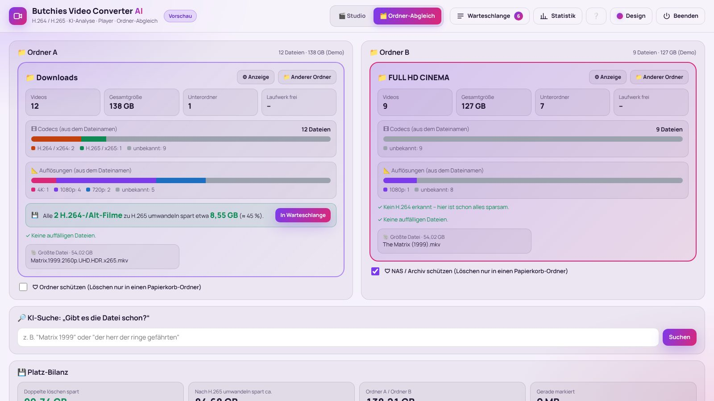
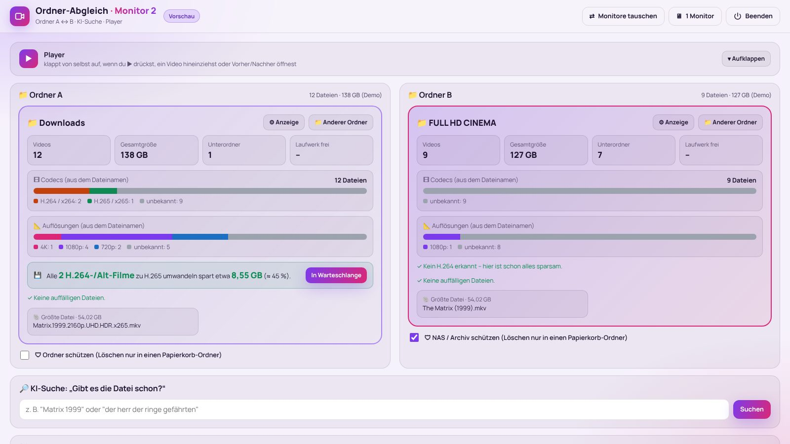
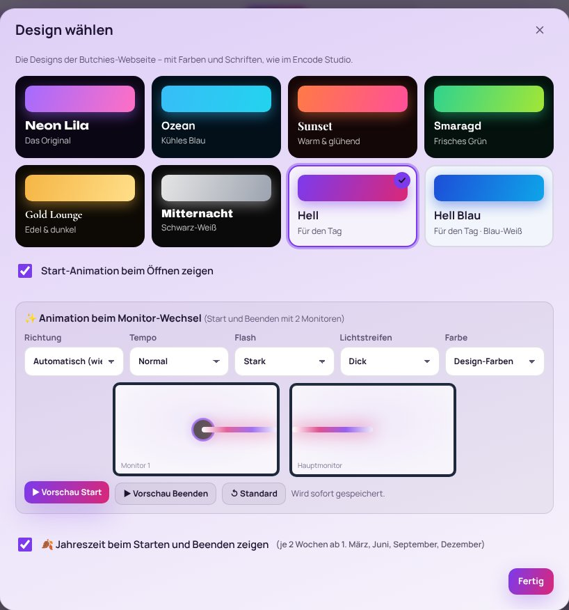

# 🎬 Butchies Video Converter AI

Windows-Programm, das deine Filme **platzsparend in H.265 (oder H.264)** umwandelt. Eine KI rechnet Größe und Qualität für dich aus. Dazu gibt es einen Player für alle Formate, einen **Vorher/Nachher-Vergleich** und einen **Ordner-Abgleich**, der doppelte Filme findet und aufräumt. Auf Wunsch läuft alles auf **zwei Monitoren**.

## ⬇️ Download

**[➜ Neueste Version herunterladen](../../releases/latest)**: die Datei **`Butchies_Video_Converter-Setup-<Version>.exe`** (z. B. `…-Setup-1.8.0.exe`) laden und starten.
Es sind keine Administratorrechte nötig, und alles Nötige ist dabei (FFmpeg, Player, WebView2). Der Installer schlägt von selbst das Laufwerk mit dem meisten freien Speicher vor.

## 🚀 Anleitung in 5 Schritten

| Schritt | So geht's |
|---|---|
| **1. Filme hineinziehen** | Dateien oder ganze Ordner in das Feld „Videos oder ganze Ordner hier hineinziehen“ ziehen, oder auf „Dateien wählen“ / „Ordner wählen“ klicken. |
| **2. KI-Note ansehen** | Rechts zeigt die **KI-Analyse** eine Note, die Größe vorher → nachher und Tipps. Alles steht auf **Auto**, du musst nichts einstellen. |
| **3. Starten** | Unten auf **▶ Umwandlung starten** klicken. Der Dateiname bleibt wie im Original. Der Codec wird angepasst (x264 → x265), und der Gruppen-Name am Ende wird zu **„-Butchies-Groove“**. |
| **4. Weggehen** | Das Fortschritts-Fenster zeigt Prozent, Tempo und Restzeit. Der PC geht nicht in den Ruhezustand. Prozessor und Grafikkarten arbeiten gleichzeitig. |
| **5. Fertig** | „📂 Im Ordner zeigen“ öffnet die fertigen Filme. Auf Wunsch kommt eine Nachricht aufs Handy, oder der PC fährt danach herunter. |

 

## 🗂️ Ordner-Abgleich

Links Ordner A (z. B. Downloads), rechts Ordner B (z. B. NAS). Die KI erkennt gleiche Filme auch bei anderem Namen und zeigt, was doppelt ist und wie viel Platz du sparen kannst. Sie legt alte H.264-Filme mit einem Klick in die Warteschlange.

- **🏷️ Gruppen-Namen ersetzen:** Nur deine eigenen, schon umgewandelten Filme werden umbenannt. Die Begleitdateien (.nfo, .srt) werden mit umbenannt. Der Ordner wird einmal eingelesen und in einer Datenbank gemerkt, danach geht es schnell. Rückgängig machen ist möglich.
- **🛡 Geschützte Ordner:** Hier wird nichts endgültig gelöscht, nur in einen Papierkorb-Ordner verschoben.

## 🖥🖥 Zwei Monitore

Mit dem Knopf **„2 Monitore“** oben rechts bleibt das Studio auf dem Hauptmonitor. Ordner-Abgleich und Player kommen auf den zweiten Bildschirm. Mit **„⇄ Monitore tauschen“** wechseln die beiden Fenster den Platz. Das Programm merkt sich beim Beenden, ob du mit zwei Monitoren gearbeitet hast.

Beim Start springt das Logo mit Lichtstreifen und Flash vom Hauptmonitor rüber. Beim Beenden springt es genau andersherum zurück.

## 🎨 Designs & Animation

Es gibt 8 Designs (Neon Lila, Ozean, Sunset, Smaragd, Gold Lounge, Mitternacht, Hell, Hell Blau). Unter **Design** stellst du die Animation beim Monitor-Wechsel ein: Richtung, Tempo, Flash, Lichtstreifen und Farbe. Eine Vorschau zeigt dir das Ergebnis sofort.

## ✨ Weitere Funktionen

- **▶️ Player & Vorher/Nachher:** spielt alle Formate ab (H.264, H.265, AV1, MKV, AVI …). Beim Vorher/Nachher wird eine Stelle echt umgewandelt. Fährst du mit der Maus über das Bild, siehst du links vorher und rechts nachher.
- **📏 Probe-Messung (VMAF):** 3 Probestücke werden echt umgewandelt und gemessen, so wie Netflix die Qualität misst.
- **⚡ Prozessor + 2 Grafikkarten:** Die Filme werden auf alle drei verteilt.
- **🎙️ Ton aufbereiten:** Sprache wird klarer, die Lautstärke gleichmäßig, und es gibt einen Nachtmodus. Das ist ein eigenes Werkzeug neben der Umwandlung.
- **📊 Statistik:** zeigt, wie viel Platz du schon gespart hast. Die KI lernt, wie schnell dein PC ist.
- **🌙 Nacht-Planer:** startet zu einer bestimmten Uhrzeit oder wenn der PC nicht benutzt wird. Läuft ein Spiel oder ein Film im Vollbild, macht er Pause.

 

## ❓ Hilfe

- **❔-Knopf** oben: startet die Kurzanleitung im Programm.
- **⚙ Einstellungen**: seltene Einstellungen (Strom, Dateinamen, Benachrichtigung).
- Neue Versionen und was sich geändert hat, stehen unter **[Releases](../../releases)**.
