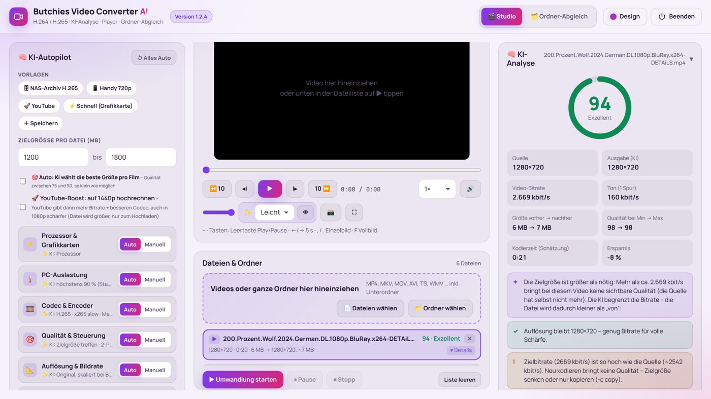
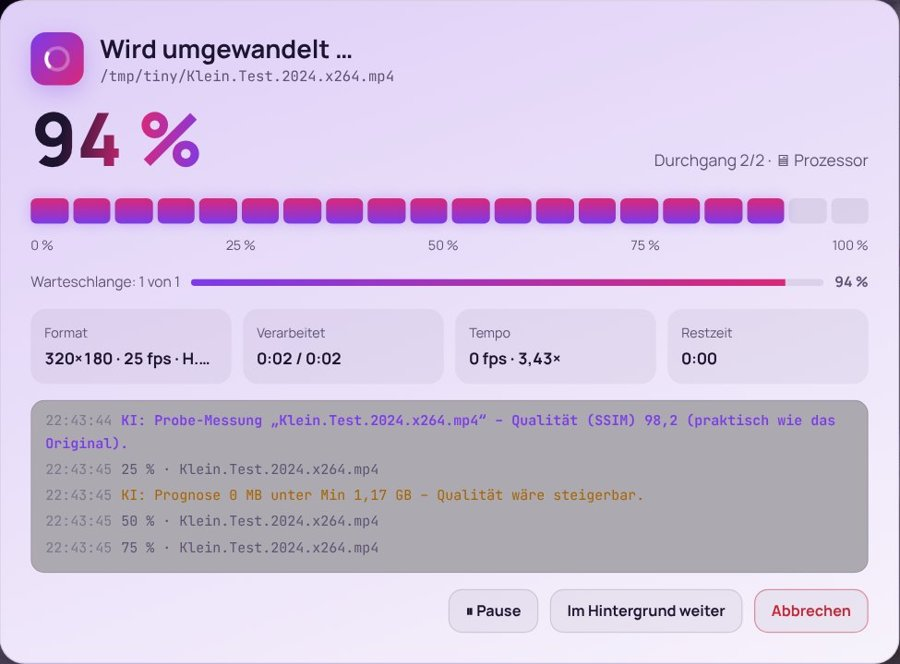
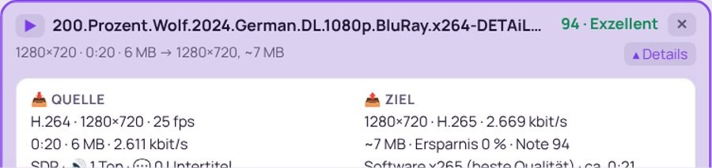
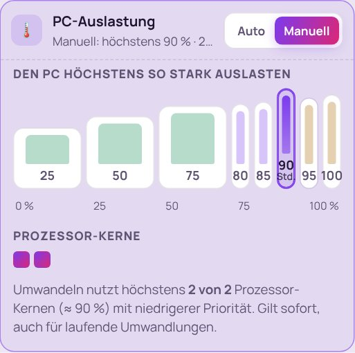
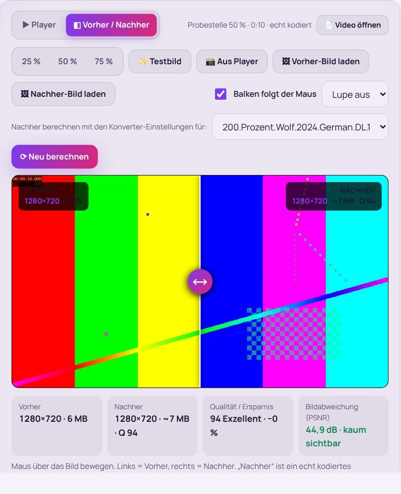
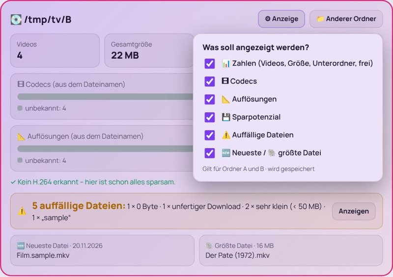

# 🎬 Butchies Video Converter AI

Windows-Programm, das deine Videos **platzsparend in H.265 (oder H.264)** umwandelt – mit KI, die Größe und Qualität für dich ausrechnet, einem eigenen Player mit **Vorher/Nachher-Vergleich** und einem **Ordner-Abgleich**, der doppelte Filme findet.

## ⬇️ Download

**[➜ Neueste Version herunterladen](../../releases/latest)** – dort die Datei **`Butchies_Video_Converter-Setup.exe`** laden und starten. Alles Nötige ist dabei (FFmpeg, Player, WebView2). Der Installer schlägt von selbst das Laufwerk mit dem meisten freien Speicher vor.

## 🚀 Kurzanleitung

| Schritt | So geht's |
|---|---|
| **1. Videos hineinziehen** | Dateien oder ganze Ordner in „Videos oder ganze Ordner hier hineinziehen“ ziehen – oder „Dateien wählen“ / „Ordner wählen“. |
| **2. KI-Note ansehen** | Rechts zeigt die **KI-Analyse** Note (z. B. 94 · Exzellent), Größe vorher → nachher und Tipps. Alles steht auf **Auto** – du musst nichts einstellen. |
| **3. Umwandlung starten** | Unten **▶ Umwandlung starten**. Steht „x264“ im Namen, fragt das Programm, ob es den Namen auf „x265“ ändern soll. |
| **4. Zuschauen oder weggehen** | Das Fortschritts-Fenster zeigt Prozent, Tempo und Restzeit. „Im Hintergrund weiter“ blendet es aus. Der PC geht nicht in den Ruhezustand, die Monitore schalten sich nach 5 Minuten aus. |
| **5. Fertig** | „📂 Im Ordner zeigen“ öffnet die fertigen Videos. |

 

## ✨ Was das Programm kann

- **🎯 Zielgröße von–bis oder „Auto“** – die KI berechnet Auflösung und Bitrate so, dass der Film in deine Größe passt, oder wählt selbst die beste Größe für eine Qualität zwischen 75 und 90.
- **🧠 KI-Autopilot** – jede Einstellung (Codec, Qualität, Auflösung, HDR, Ton/Untertitel, Ausgabe) steht auf *Auto*; mit *Manuell* klappt sie auf.
- **📏 Probe-Messung (VMAF)** – wandelt 3 Probestücke echt um und misst die Qualität wie Netflix.
- **⚡ Prozessor + 2 Grafikkarten gleichzeitig** – verteilt die Filme auf CPU, Radeon RX 7000 und Radeon 760M.
- **🌡️ PC-Auslastung begrenzen** – Standard 90 %, einstellbar von 25 bis 100 %.
- **📋 Warteschlange mit Details** – pro Film Quelle, Ziel, Probe-Messung, Ausgabename und Warnungen.

 

### ▶️ Player & Vorher/Nachher
Spielt alle Formate (H.264, H.265, AV1, MKV, AVI …). Im **Vorher/Nachher** wird eine Stelle echt umgewandelt – Maus über das Bild bewegen: links vorher, rechts nachher.

### 🗂️ Ordner-Abgleich
Zwei Ordner vergleichen (z. B. Downloads ↔ NAS): **Schon vorhanden**, **Ähnlich**, **Nur in A/B** – auch bei anderem Dateinamen. Mit Ordner-Infos (Codecs, Auflösungen, Sparpotenzial, auffällige Dateien), KI-Suche, Hash-Prüfung, einheitlichem Umbenennen und Papierkorb-Schutz fürs NAS.

### 🎨 Und sonst
7 Designs (auch Hell), Start-/Abschiedsanimation mit Jahreszeiten, Vollbild und Wechsel auf den 2. Bildschirm. Beim Beenden merkt sich das Programm alles: Einstellungen, Dateiliste und Abgleich-Ordner.

## 🛠️ Für Entwickler

| Datei | Inhalt |
|---|---|
| `butchies_video_converter.py` | Programm-Kern (Python, lokaler Server, FFmpeg-Steuerung, Selbsttest `--selftest`) |
| `ui/index.html` | Oberfläche (eine Datei) |
| `installer.iss` | Inno-Setup-Installer |
| `.github/workflows/build.yml` | baut bei jedem Push auf `main` den Installer und veröffentlicht ihn als Release |
| `design-kit/` | Design-Unterlagen (Start-/Beenden-Animation) |
